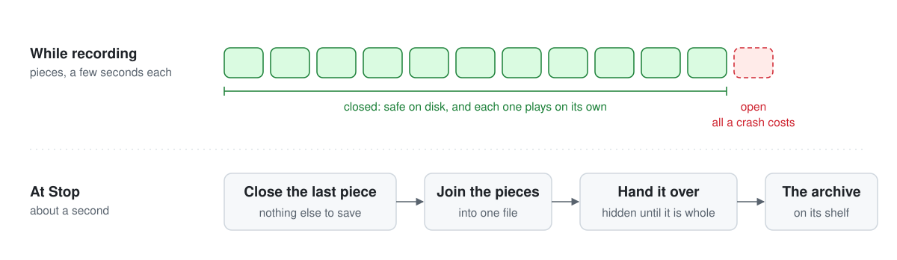

<p align="center">
  <picture>
    <source media="(prefers-color-scheme: dark)" srcset="docs/brand/logo-animated-dark.svg">
    
  </picture>
</p>

<p align="center">
  <strong>A recorder that never loses a meeting.</strong><br>
  The recording plays from disk from its first seconds, so nothing is left to fail when you press Stop.
</p>

<p align="center">
  
  
  
  
  
</p>

<br>

Most screen recorders hold a recording together with an index they write at the very end. If that last step fails, or the app or the computer dies first, the whole recording is gone, however long it ran. On Air works the other way round. It writes short pieces that each play on their own, so the recording exists from the moment it starts, and the end has nothing left to get wrong.

| Most recorders | On Air |
| :-- | :-- |
| Write the index at Stop. A failure there costs the whole recording | Writes pieces a few seconds long. A crash costs at most the piece that was open |
| Take longer to stop the longer they ran | Closes one piece, in about a second |
| Leave a file for someone to rename, move and upload | Hands each finished recording to its archive by itself, whole or not at all, through a proved core |
| Keep going until someone remembers to stop them | Will ask when a recording runs long, and stop cleanly before the disk fills. The disk guard is [#10](https://github.com/gitdek/onair/issues/10) |

> **Status: milestone one, under way.** The recorder runs from the menu bar and keeps each recording in pieces that survive a kill. It was checked by hand on the owner's Mac on 14 November 2026: recording with the microphone, Stop and playback, a hard kill and what it recovered, a covered window, and an area of a display. Asking for the microphone before a recording starts is done, and was checked by hand the same day: macOS asked before the first recording, and that recording had the voice. Each finished recording is handed to the folder picked from the menu, the one On the Record watches, through the hand-over's proved core, and waits for its check by hand. Still to come for milestone one: the proved cores of a recording's life, its pieces and the disk guard, asking when a recording runs long, carrying a recording on after a crash, and the milestone's own hand checks. [`docs/PRD.md`](docs/PRD.md) is the spec, and [`SPEC.md`](SPEC.md) says what exists today and what was checked.

## How it works

<picture>
  <source media="(prefers-color-scheme: dark)" srcset="docs/assets/how-it-works-dark.svg">
  
</picture>

1. **Record in pieces.** Picture and sound go to disk a few seconds at a time. Every closed piece is a small recording of its own, and nothing is held back for the end.
2. **Stop in a second.** Stop closes the piece that's open. A three-hour meeting stops as fast as a three-minute one.
3. **Join, then hand over.** The pieces become one file, which goes to the archive's folder under a hidden name and takes its real name only once it matches On Air's own copy byte for byte, never replacing a file that is there. On Air keeps its own copy three days more. A hand-over cut short anywhere carries on at the next launch, without a second copy.
4. **Come back from anything.** If On Air stops mid-meeting, the closed pieces are still there, and the next launch joins them into a recovered file, as a hard kill showed by hand. A power loss hasn't been tried yet, and picking the same recording up again, with the gap marked, is still to come.

On Air is the live side of On the Record, a meeting archive that turns each recording into something to play, read and search. Later milestones use that: while a meeting happens, On Air shows what the conversation connects to.

## The rules it holds

On Air is built with [Invariant](https://github.com/gitdek/invariant). The rules come first: a person ratifies what must always be true, and only then is the code written and checked against it on every pull request.

| # | Rule | How it will be held | Today |
| :-- | :-- | :-- | :-- |
| 1 | One recording at a time. A second Start is refused, and says so | Proved | Built and tested. Its proof is to come in [#8](https://github.com/gitdek/onair/issues/8) |
| 2 | Every recording that starts ends one of two ways: handed over, or kept on disk with its error shown. None is dropped silently | Proved | Built and tested. Its proof is to come in [#8](https://github.com/gitdek/onair/issues/8) |
| 3 | A closed piece is never changed or removed until its recording has been handed over | Proved | Holds, since nothing removes a piece yet. Its proof is to come in [#9](https://github.com/gitdek/onair/issues/9) |
| 4 | After any stop, crash or power loss, On Air can tell which pieces are whole, and loses at most the open one | Proved for the bookkeeping, tried by hand for the files | Tested, and a hard kill was tried by hand. Its proof is to come in [#9](https://github.com/gitdek/onair/issues/9) |
| 5 | The archive's folder never shows a partial file | Proved, and tested on a real folder | Proved in the hand-over's core, which the app calls, and tested on a real folder with a kill at every step |
| 6 | Each recording is handed over once. A retry after a crash never leaves two copies | Proved | Proved in the same core, and tested the same way |
| 7 | On Air removes its own copy only after the handed-over file matches it byte for byte | Proved | Proved in the same core, and tested on a clock: the copy goes three days after the hand-over |
| 8 | It never starts without room to spare, and stops cleanly before the disk fills | Proved, and tested with a fake disk | Not built yet: [#10](https://github.com/gitdek/onair/issues/10) |
| 9 | A failed join never costs the recording: the pieces stay on disk while the join is tried again, a piece that can't be read is left out with the gap marked, and the archive only ever gets one file for a recording | Proved, and tried by hand | The pieces are kept, the menu says where, and the next launch tries the join again, tested. Not built yet: asking for the join again, and leaving out a piece that can't be read, which today fails the join. Its proof is to come in [#9](https://github.com/gitdek/onair/issues/9) |
| 10 | Stop takes about a second, however long the recording ran | Tested, and tried by hand | Tested, and Stop was tried by hand |
| 11 | In the archive's folder On Air writes only its own files | Tested | Tested: the recording's name and its hidden one are all it asks for there |
| 12 | It records only between Start and Stop, shows that it's recording, and sends nothing off the computer | Tried by hand, with a test that the core has no network code | Built. The test for network code isn't written yet |

**Proved** means a small model of the rule, which a model checker explores in every order of events at small sizes, crashes included, and Go code proved to follow that model. It covers On Air's own decisions. It doesn't cover macOS, the disk or the encoder, which is what the checks by hand are for.

## How it's built

One Go app in two layers, and only one of them makes decisions.

| Layer | What it does | How it's checked |
| :-- | :-- | :-- |
| **The core**, plain Go | Decides when to start and stop, keeps track of which pieces are whole, joins them, and hands the file over | Models and proofs for the rules, tests for the rest. Today one part is proved, the hand-over's, whose steps are tested on real folders, and the rest is tested against a fake edge. Builds and tests on any machine |
| **The edge**, cgo and small Objective-C files | Draws the menu-bar dot, captures the screen and the sound, and reports what happened | Tried by hand on the owner's Mac, on 14 November 2026. It does what the core tells it and decides nothing |

## Milestones

| Milestone | What it adds |
| :-- | :-- |
| **1. Never lose a recording** | The menu-bar recorder, pieces on disk, recovery after a crash, the disk and length guards, and the hand-over |
| **2. Stops when the meeting does** | Stops by itself when the call ends, names the recording, makes a lighter copy, and leaves a transcript beside the video |
| **3. Live context** | While a meeting happens, a panel shows the earlier moments, notes and open items the conversation connects to. The spec says [where it's headed](docs/PRD.md#where-milestone-three-is-headed) |

## Status

- [x] **Founding.** The spec's first cut, the rules for agents, the checks and the gate.
- [ ] **Milestone one.** Under way.
  - [x] The menu-bar recorder. It records the display, area or window a person picks, with its sound and the microphone mixed into one track, in pieces that each play on their own, joins them at Stop and recovers them after a kill. Checked by hand on the owner's Mac on 14 November 2026: recording with the microphone, Stop and playback, a hard kill and its recovery, a covered window, and an area of a display.
  - [x] The hand-over's core, proved and merged from [#1](https://github.com/gitdek/onair/issues/1), and released as `core/handover/v0.1.0` for the app to require.
  - [x] Asking for the microphone before a recording starts, and saying when it isn't heard ([#7](https://github.com/gitdek/onair/issues/7)). Checked by hand on 14 November 2026: macOS asked before the first recording, and that recording had the voice. A refused or silent microphone hasn't been tried by hand.
  - [ ] Handing each recording to On the Record's folder through that core ([#11](https://github.com/gitdek/onair/issues/11)). Built, and waiting for its check by hand.
  - [ ] The proved cores of a recording's life ([#8](https://github.com/gitdek/onair/issues/8)), its pieces ([#9](https://github.com/gitdek/onair/issues/9)) and the disk guard ([#10](https://github.com/gitdek/onair/issues/10)).
  - [ ] Asking at two hours and stopping at four, and carrying a recording on after a crash.
  - [ ] The milestone's hand checks in [`docs/PRD.md`](docs/PRD.md#trying-milestone-one-by-hand), among them a 60-minute call, a power loss, a full disk and a broken join.
- [ ] **Milestone two.**
- [ ] **Milestone three.**

## Working here

```bash
go vet ./...
go test ./...
tools/check-format
go run ./cmd/onair selftest       # on a Mac: made-up picture and sound through the real writer, no permission asked
tools/build-app                   # on a Mac: builds On Air.app into build/
python3 docs/assets/generate.py   # redraws the README's graphics
```

Every change starts as an issue and goes through a pull request and the gate. [`AGENTS.md`](AGENTS.md) has the rules for coding agents.
