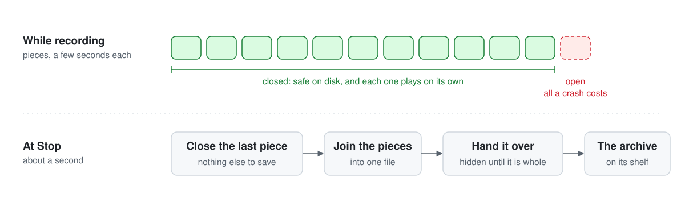

<p align="center">
  <picture>
    <source media="(prefers-color-scheme: dark)" srcset="docs/brand/logo-animated-dark.svg">
    
  </picture>
</p>

<p align="center">
  <strong>A recorder that never loses a meeting.</strong><br>
  The recording plays from disk from its first seconds, so nothing is left to fail when you press Stop.
</p>

<p align="center">
  
  
  
  
  
</p>

<br>

Most screen recorders hold a recording together with an index they write at the very end. If that last step fails, or the app or the computer dies first, the whole recording is gone, however long it ran. On Air works the other way round. It writes short pieces that each play on their own, so the recording exists from the moment it starts, and the end has nothing left to get wrong.

| Most recorders | On Air |
| :-- | :-- |
| Write the index at Stop. A failure there costs the whole recording | Writes pieces a few seconds long. A crash costs at most the piece that was open |
| Take longer to stop the longer they ran | Closes one piece, in about a second |
| Leave a file for someone to rename, move and upload | Hands each finished recording to its archive by itself, whole or not at all |
| Keep going until someone remembers to stop them | Asks when a recording runs long, and stops cleanly before the disk fills |

> **Status: milestone one, under way.** The recorder runs from the menu bar and keeps each recording in pieces that survive a kill, and the hand-over's core is proved, though nothing calls it yet. It hasn't been through its hand checks. [`docs/PRD.md`](docs/PRD.md) is the spec, and [`SPEC.md`](SPEC.md) says what exists today.

## How it works

<picture>
  <source media="(prefers-color-scheme: dark)" srcset="docs/assets/how-it-works-dark.svg">
  
</picture>

1. **Record in pieces.** Picture and sound go to disk a few seconds at a time. Every closed piece is a small recording of its own, and nothing is held back for the end.
2. **Stop in a second.** Stop closes the piece that's open. A three-hour meeting stops as fast as a three-minute one.
3. **Join, then hand over.** The pieces become one file, which goes to the archive's folder under a hidden name and takes its real name only when it's whole. On Air keeps its own copy until the two match byte for byte.
4. **Come back from anything.** If the app, its recorder or the computer stops mid-meeting, the closed pieces are still there. On Air picks the same recording up again, marks the gap and says so.

On Air is the live side of On the Record, a meeting archive that turns each recording into something to play, read and search. Later milestones use that: while a meeting happens, On Air shows what the conversation connects to.

## The rules it holds

On Air is built with [Invariant](https://github.com/gitdek/invariant). The rules come first: a person ratifies what must always be true, and only then is the code written and checked against it on every pull request.

| # | Rule | How it will be held |
| :-- | :-- | :-- |
| 1 | One recording at a time. A second Start is refused, and says so | Proved |
| 2 | Every recording that starts ends one of two ways: handed over, or kept on disk with its error shown. None is dropped silently | Proved |
| 3 | A closed piece is never changed or removed until its recording has been handed over | Proved |
| 4 | After any stop, crash or power loss, On Air can tell which pieces are whole, and loses at most the open one | Proved for the bookkeeping, tried by hand for the files |
| 5 | The archive's folder never shows a partial file | Proved, and tested on a real folder |
| 6 | Each recording is handed over once. A retry after a crash never leaves two copies | Proved |
| 7 | On Air removes its own copy only after the handed-over file matches it byte for byte | Proved |
| 8 | It never starts without room to spare, and stops cleanly before the disk fills | Proved, and tested with a fake disk |
| 9 | A failed join never costs the recording: the pieces that play are handed over instead | Proved, and tried by hand |
| 10 | Stop takes about a second, however long the recording ran | Tested, and tried by hand |
| 11 | In the archive's folder On Air writes only its own files | Tested |
| 12 | It records only between Start and Stop, shows that it's recording, and sends nothing off the computer | Tried by hand, with a test that the core has no network code |

**Proved** means a small model of the rule, which a model checker explores in every order of events at small sizes, crashes included, and Go code proved to follow that model. It covers On Air's own decisions. It doesn't cover macOS, the disk or the encoder, which is what the checks by hand are for.

## How it's built

One Go app in two layers, and only one of them makes decisions.

| Layer | What it does | How it's checked |
| :-- | :-- | :-- |
| **The core**, plain Go | Decides when to start and stop, keeps track of which pieces are whole, joins them and hands the file over | Models and proofs for the rules, tests for the rest. Builds and tests on any machine |
| **The edge**, cgo and small Objective-C files | Draws the menu-bar dot, captures the screen and the sound, and reports what happened | Tried by hand on a Mac. It does what the core tells it and decides nothing |

## Milestones

| Milestone | What it adds |
| :-- | :-- |
| **1. Never lose a recording** | The menu-bar recorder, pieces on disk, recovery after a crash, the disk and length guards, and the hand-over |
| **2. Stops when the meeting does** | Stops by itself when the call ends, names the recording, makes a lighter copy, and leaves a transcript beside the video |
| **3. Live context** | While a meeting happens, a panel shows the earlier moments, notes and open items the conversation connects to |

## Status

- [x] **Founding.** The spec's first cut, the rules for agents, the checks and the gate.
- [ ] **Milestone one.** Under way. Built: the menu-bar recorder, which records the main display with its sound and the microphone mixed into one track, in pieces that each play on their own, joins them at Stop and recovers them after a kill; and the hand-over's core, proved, which nothing calls yet. To come: the hand-over itself, the disk and length guards, carrying a recording on after a crash, and the hand checks on the owner's Mac.
- [ ] **Milestone two.**
- [ ] **Milestone three.**

## Working here

```bash
go vet ./...
go test ./...
tools/check-format
go run ./cmd/onair selftest       # on a Mac: made-up picture and sound through the real writer, no permission asked
tools/build-app                   # on a Mac: builds On Air.app into build/
python3 docs/assets/generate.py   # redraws the README's graphics
```

Every change starts as an issue and goes through a pull request and the gate. [`AGENTS.md`](AGENTS.md) has the rules for coding agents.
